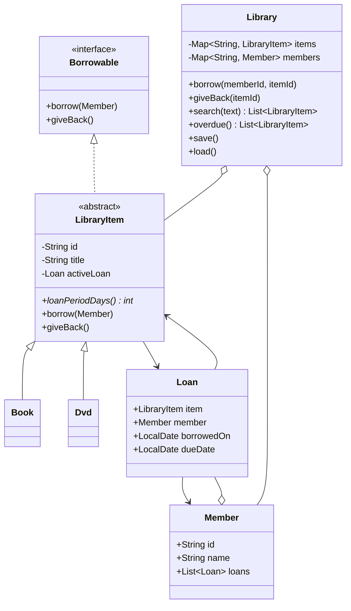

# Lab 11 — Class diagram

`Book` and `Dvd` specialize `LibraryItem`; both inherit the borrowing contract while choosing different loan periods. `Library` coordinates collections, operations and persistence. A `Loan` connects a member and an item and records the start and due dates.
